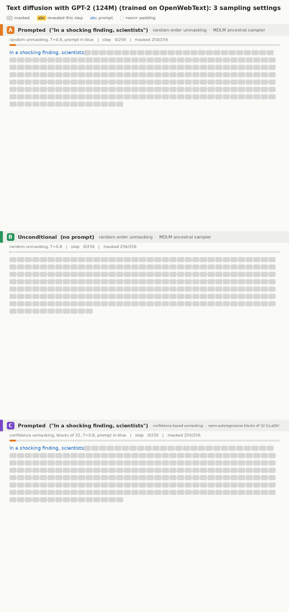
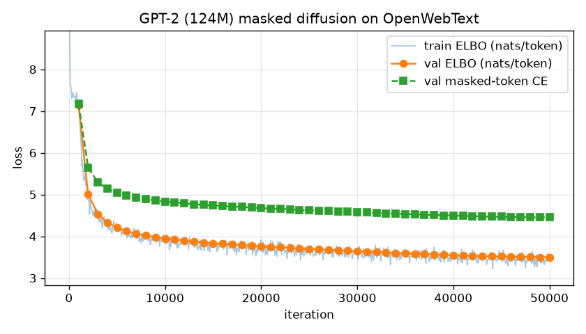

# dllm — a GPT-2 (124M) text-diffusion model trained on OpenWebText

A from-scratch PyTorch implementation of a **masked discrete diffusion language
model** (the MDLM / LLaDA recipe). The denoiser is a **GPT-2 small**-size transformer
written from scratch (no `transformers` import) with bidirectional attention, trained from
random init on [OpenWebText](https://www.kaggle.com/datasets/windmaple/openwebtext-gpt2) with
DDP on a Cloud TPU v5e-8 via [TorchTPU](https://github.com/google-pytorch/torch_tpu).



Generation goes from a fully masked 256-token canvas to finished text, one token per step:

- **A** — prompted with "In a shocking finding, scientists", random-order unmasking
- **B** — unconditional (no prompt), random-order unmasking
- **C** — prompted, confidence-based unmasking with semi-autoregressive blocks of 32 (LLaDA-style)

GIF legend: grey box = `<mask>`, yellow = tokens revealed at this step, blue = prompt,
outlined box = `<|endoftext|>` (document boundary).

## How it works

| | Autoregressive GPT-2 | This model (masked diffusion) |
|---|---|---|
| Attention | causal | **bidirectional** (`is_causal=False`) |
| Corruption | — | each token → `<mask>` with prob. `t ~ U(0,1)` |
| Training loss | next-token CE | `(1/t) · CE on masked tokens` (continuous-time ELBO) |
| Generation | left → right, 1 token / step | start from all `<mask>`, reveal ~`L/steps` tokens per step, in any order |

**Sampling.** We start from a fully masked canvas. Each step the model predicts every masked position,
and we commit a random subset (`--strategy random`, the vanilla MDLM sampler) or the most confident
predictions (`--strategy confidence`, as in LLaDA, optionally in left-to-right blocks with `--block_len`).

**Model** (default): GPT-2 small — 12 layers, 12 heads, 768-d, 1024 context, learned positional
embeddings, pre-LayerNorm, GELU MLP, tied input/output embeddings — ~124M params.

**Tokenizer / data.** GPT-2 BPE (50,257 tokens) + `<mask>` = 50257, padded to 50,304 (a multiple of
128). OpenWebText comes pre-tokenized from the Kaggle dataset
[windmaple/openwebtext-gpt2](https://www.kaggle.com/datasets/windmaple/openwebtext-gpt2) (nanoGPT's
`prepare.py` format: 9.04B train / 4.4M val tokens, documents separated by `<|endoftext|>`); training
samples are random 1024-token windows of the packed stream.

## Files

| File | Purpose |
|---|---|
| [`model.py`](model.py) | GPT-2-style bidirectional transformer from scratch |
| [`diffusion.py`](diffusion.py) | forward masking process, ELBO loss, iterative-unmasking sampler |
| [`owt.py`](owt.py) | OpenWebText download (pre-tokenized, from Kaggle), GPT-2 tokenizer, packed dataset |
| [`data.py`](data.py) | TinyStories download/tokenization, compact tokenizer (see [TinyStories](#tinystories)) |
| [`train.py`](train.py) | training loop (AdamW, warmup + cosine LR, grad accumulation, eval, checkpoints; CPU / TPU, DDP, W&B) |
| [`sample.py`](sample.py) | batched sampling on all TPU chips at once (one process per chip), samples → `.jsonl` |
| [`visualize.py`](visualize.py) | sample + render the denoising trajectory as a GIF (CPU or TPU) |
| [`plot_loss.py`](plot_loss.py) | training / validation curves |
| [`stack_gifs.py`](stack_gifs.py) | stack the three GIFs into one labelled comparison GIF |

## Usage

```bash
pip install torch tiktoken numpy pillow matplotlib kaggle  # + wandb (optional); torch_tpu for TPU
python owt.py                          # -> /dev/shm/owt/{train,val}.bin (18 GB; needs KAGGLE_USERNAME / KAGGLE_KEY)
                                       #    /dev/shm is RAM-backed and cleared on reboot

# train on all chips of a TPU VM (defaults = the run below)
eval $(python -m torch_tpu._internal.distributed.distributed | sed 's/^/export /')   # TPU topology env
TORCH_TPU_DEFER_AND_FUSE=1 torchrun --standalone --nproc_per_node=$WORLD_SIZE train.py --wandb
                                       # -> out/ckpt.pt, out/log.jsonl
python plot_loss.py                    # -> assets/loss.png

# GIFs (random-order unmasking by default, 256 tokens in 256 steps = 1 token / step)
P="In a shocking finding, scientists"
python visualize.py --device tpu --prompt "$P" --seed 1 --out assets/diffusion_prompt.gif
python visualize.py --device tpu --seed 2 --out assets/diffusion_uncond.gif
python visualize.py --device tpu --prompt "$P" --strategy confidence --block_len 32 --seed 2 \
    --out assets/diffusion_block_confidence.gif
python stack_gifs.py                   # -> assets/diffusion_stacked.gif (A/B/C comparison)
```

Sampling on TPU takes ~3 s per 256-token / 256-step sample (vs minutes on CPU).

### Parallel sampling on all TPU chips

Denoising one sequence is sequential (each step depends on the previous one), and a single step of the
124M model is far too small to split across chips, so the parallelism is across samples: `sample.py`
denoises a batch of `--num_samples` sequences per chip and runs one process per chip (different seeds);
rank 0 gathers everything into a `.jsonl`.

```bash
eval $(python -m torch_tpu._internal.distributed.distributed | sed 's/^/export /')
TORCH_TPU_DEFER_AND_FUSE=1 torchrun --standalone --nproc_per_node=$WORLD_SIZE sample.py \
    --prompt "In a shocking finding, scientists" --num_samples 64 --out samples.jsonl
```

Throughput for 256-token samples (v5e-8, bf16):

| setup | steps | samples/s | tokens/s |
|---|---|---|---|
| 1 chip, 1 sample at a time (strict eager) | 256 | 0.24 | 61 |
| 1 chip, batch 16 / 64 (fused eager) | 256 | 1.8 / 2.2 | 469 / 553 |
| **8 chips × batch 64** (fused eager) | 256 | **16.0** | **4,092** |
| 8 chips × batch 64, 2 / 4 tokens per step | 128 / 64 | 33.8 / 58.1 | 8,660 / 14,885 |

All 8 chips scale linearly (~67× the one-at-a-time baseline at 256 steps). Fewer `--steps` reveals more
tokens per step, which is faster but trades off sample quality (not measured here).

### TPU (TorchTPU) and multi-device (DDP) training

`train.py` picks the device with `--device auto|tpu|cpu` (auto: TPU if available, else CPU). On TPU it
uses TorchTPU (`torch_tpu`, auto-loaded by `import torch`) and computes the loss with static tensor
shapes, so XLA compiles the step once instead of every iteration. Under `torchrun` it runs DDP with one
process per device (`tpu_dist` on TPU, `gloo` on CPU); `--batch_size` is per process and per
micro-step, so the global batch is `batch_size × grad_accum × world size`.

On TPU, `--nproc_per_node` must equal the `WORLD_SIZE` printed by the environment command (one rank
per chip), otherwise the ranks hang waiting for each other. On a machine with `torch_tpu` installed, CPU
DDP needs `TORCH_DEVICE_BACKEND_AUTOLOAD=0`; otherwise `torch.manual_seed` also seeds the TPU and
expects the TPU distributed env.

**Throughput and memory** (v5e-8, per-chip numbers, 1024-token sequences):

| setting | per-chip batch | tokens/s/chip | peak HBM |
|---|---|---|---|
| strict eager (default) | 8 | 53k | 11.7 GiB |
| `torch.compile(backend="tpu")` | 8 | 24k | 15.3 GiB |
| **fused eager** (`TORCH_TPU_DEFER_AND_FUSE=1`) | 8 / 10 / 12 | 76k / ~82k / 80k | 9.1 / 13.0 (DDP) / 12.4 GiB |

Memory is dominated by the `(B, 1024, 50304)` logits. Batch 12 fits on its own but leaves too little
headroom once DDP buffers and eval are added, hence the default 10 × `--grad_accum 6`
(480 sequences = 0.49M tokens per optimizer step).

### Weights & Biases logging

Add `--wandb` (optionally `--wandb_project`, default `dllm`, and `--wandb_run_name`) to log from rank 0:
train / val ELBO and masked-token CE, grad norm, LR, ms/iter, tokens/s, peak TPU HBM, tokens seen, and
the per-eval samples as a table. Needs `pip install wandb` and `WANDB_API_KEY` (or `wandb login`). With
`--resume`, logging continues in the same W&B run (its id is stored in the checkpoint).

## Results

Trained from scratch with DDP on a Cloud TPU v5e-8 (8 chips, TorchTPU fused eager, bf16 autocast) with
the default settings: 50,000 steps × 480 sequences × 1024 tokens (≈24.6B tokens, ≈2.7 epochs of
OpenWebText), AdamW, LR 6e-4 (2k warmup, cosine to 6e-5), ~750 ms/step (~655k tokens/s),
peak HBM 13.0 GiB per chip, **~10.5 h** wall-clock.

| | value |
|---|---|
| final val ELBO | **3.499 nats/token** (perplexity upper bound ≤ 33.1) |
| final val masked-token CE | 4.453 |



Still improving at the end (5.01 / ≤150 at 2k steps, 3.95 / ≤52 at 10k, 3.64 / ≤38 at 30k). For scale,
MDLM reports a bound of ≈23 on OWT with a similar-size model trained on ~10× more tokens (262B). The first
~1.5k steps sit on the masked-LM unigram plateau (ELBO ≈ 7.1, context unused) until the LR warms up;
that is expected, not a bug (TPU numerics were checked against CPU there).

### Sampler matters

| sampler | behaviour |
|---|---|
| `random` (MDLM ancestral, default), prompted | locally fluent, GPT-2-like text; weak long-range coherence |
| `random`, unconditional | weaker; often falls into loops ("start your own business …") |
| `confidence` + `--block_len 32` (LLaDA semi-AR) | degenerates into repetition ("the results of the contents of the body …") |

Sample (random unmasking, panel A of the GIF):

> In a shocking finding, scientists found a new record that contains the different types of fossil
> coming from a different tree. This new type of fossil works with the ability to analyze and analyze the
> very different forms of evolution. “Scientists said the fossil record from the tree contains fossils
> that come from fossil foundations, as well as from many different species of plants – all from the
> same species.” …

## TinyStories

The code still supports the original small setup: a 13.8M-param miniGPT (6 layers, 6 heads, 384-d,
256 context) on [TinyStories](https://huggingface.co/datasets/roneneldan/TinyStories), with GPT-2 BPE
remapped to the 8,189 most frequent TinyStories tokens + `<eos>` / `<mask>` / `<unk>`, one story per
sample (right-padded with `<eos>`, so the model also decides where the story ends).

```bash
python data.py --train_files 4 --out_dir data_full   # all 4 shards: 2.12M stories, 474M tokens
torchrun --standalone --nproc_per_node=$WORLD_SIZE train.py --dataset tinystories --data_dir data_full \
    --out_dir out_tinystories --n_layer 6 --n_head 6 --n_embd 384 --block_size 256 --batch_size 224 \
    --grad_accum 1 --max_iters 5714 --lr 2e-3 --min_lr 2e-4 --warmup_iters 150 --eval_interval 500
python visualize.py --ckpt out_tinystories/ckpt.pt --data_dir data_full --prompt "Once upon a time"
```

On the v5e-8 this takes ~16 min (batch 224 per chip ≈ 87% of HBM) and reaches val ELBO 1.415
nats/token (perplexity bound ≤ 4.1); with batch 64 per chip and LR 1e-3 for 20k steps (~22 min) it
reaches 1.385. On TinyStories, confidence + blocks of 32 is the most fluent sampler, while confidence over
the whole sequence collapses to ~20-token stories (the trailing `<eos>` padding is the most confident
prediction, so it is committed first).
